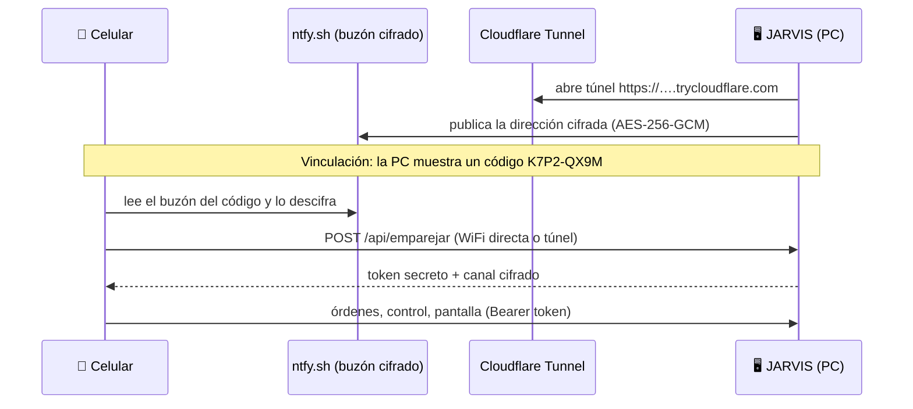

# J.A.R.V.I.S. para Android

**El control remoto y la voz de mi [JARVIS de escritorio](https://github.com/AbnerGA7/JARVIS), en el celular**

*Le hablo desde el celular, con WiFi o con datos móviles, y JARVIS hace las cosas en mi PC.*

---

## ✨ Qué hace

| | |
|---|---|
| 🎙️ **Asistente por voz** | Reactor animado, micrófono y voz en español. Las órdenes llegan al JARVIS de la PC |
| 📱 **Modo celular** | Si la PC está apagada, JARVIS responde con Groq desde el teléfono: abre apps, alarmas, temporizador, linterna, mapas, llamadas |
| 🎛️ **Control** | Volumen, música, brillo, bloquear, suspender, apagar, rutinas (modo gamer, modo estudio) y estado de la PC |
| 🖥️ **Pantalla en vivo** | Ve la pantalla de la PC y úsala con un touchpad y un teclado |
| 🧩 **Apps de la PC** | Lista de todos los programas instalados para abrirlos con un toque |
| 🌐 **Desde cualquier lugar** | Misma WiFi → conexión directa. Datos móviles → túnel seguro de Cloudflare |
| 🔒 **Seguro** | Vinculación con código de un solo uso, token secreto de 256 bits y direcciones cifradas con AES-256-GCM |
| 🤖 **Botón de asistente** | Se puede elegir como asistente digital de Android para abrirlo con el gesto del sistema |

## 🔗 Cómo se conecta

1. En la misma WiFi, la app encuentra la PC sola con un mensaje UDP (`JARVIS?`) y se conecta directo.
2. Con datos móviles usa el túnel. Como su dirección cambia en cada arranque, la PC la publica **cifrada** y solo el celular vinculado puede leerla.

## 📦 Instalación

1. Descarga **JARVIS.apk** desde [Releases](https://github.com/AbnerGA7/JARVIS-Android/releases/latest) e instálala.
2. En la laptop: clic derecho en el reactor de JARVIS → **Conectar celular**.
3. Escribe en la app el código que aparece en la PC (por ejemplo `K7P2-QX9M`). Listo.

> Necesita JARVIS 2.3 o superior en la PC.

## 🏗️ Estructura

| Archivo | Qué hace |
|---|---|
| `Enlace.kt` | Encuentra la PC (WiFi/UDP o túnel), vincula y hace los pedidos |
| `Cripto.kt` | AES-256-GCM y derivación de claves, idénticos a `tunel.py` de la PC |
| `Voz.kt` | Reconocimiento de voz (es-PE) y voz de JARVIS |
| `ModoLocal.kt` | JARVIS sin PC: Groq + acciones del teléfono |
| `JarvisVM.kt` | Estado de la app y lógica de conversación |
| `ui/Tema.kt` | Colores, tipografía y el reactor animado |
| `ui/Pantallas.kt` | Asistente, Control, Pantalla, Apps y Ajustes |

## 🛠️ Compilar

Cada cambio en `main` se compila solo con GitHub Actions y se publica en *Releases*.
Para compilar a mano: Android Studio (JDK 17) → *Build → Build APK(s)*.

---

Hecho con ☕ por <a href="https://github.com/AbnerGA7">AbnerGA7</a> · Lima, Perú

